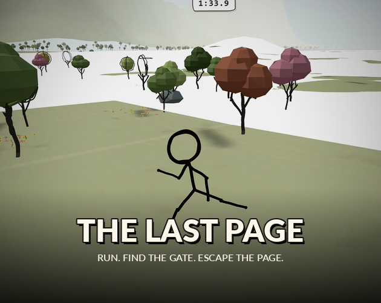
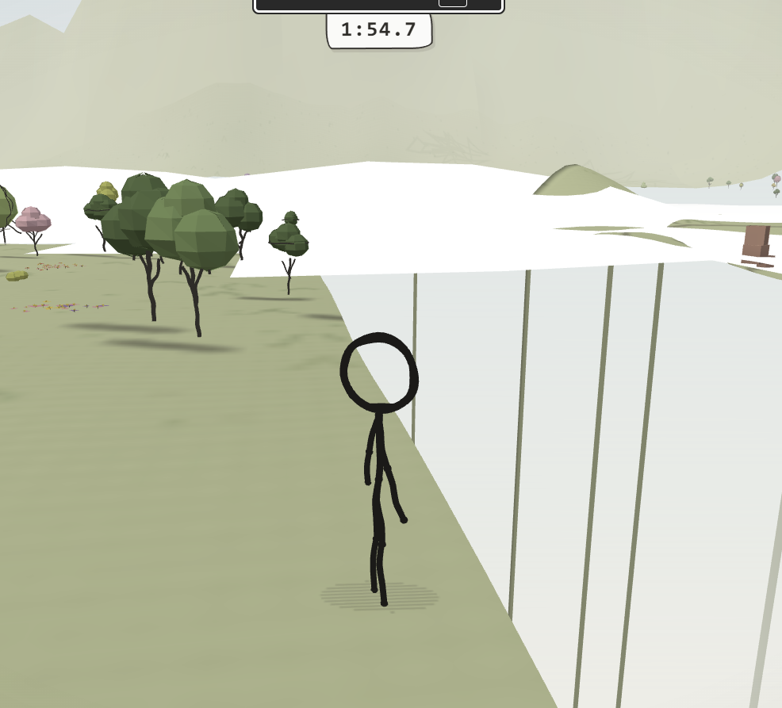
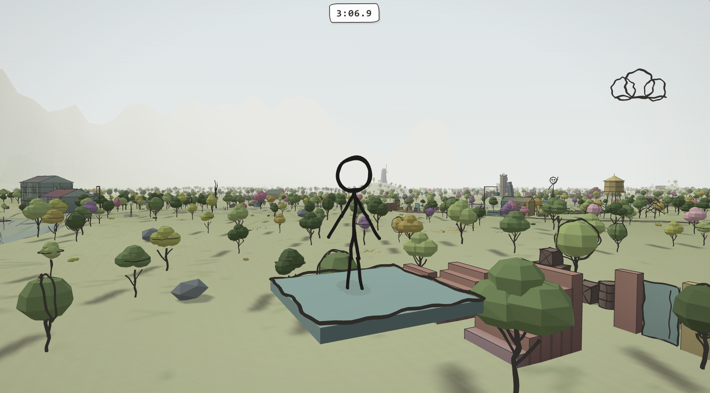
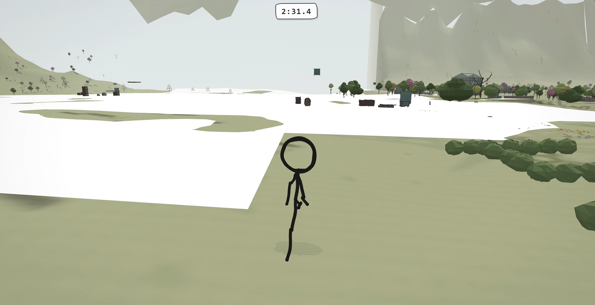
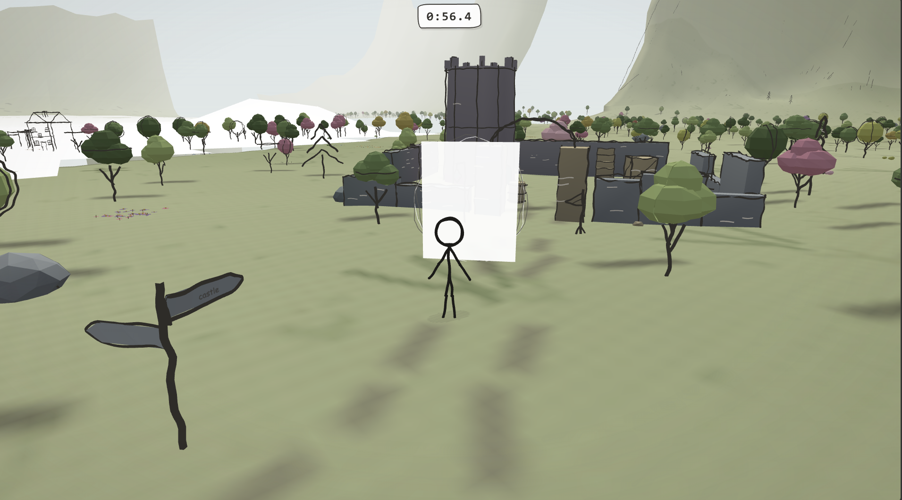
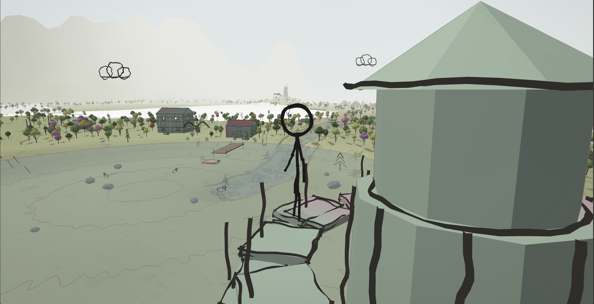

# The Last Page

A timed 3D exploration and survival game in which a hand-drawn world is gradually erased. The player must navigate to the next page before time runs out and the route disappears.

**Links:** [Play on itch.io](https://abprojects.itch.io/the-last-page) · [Technical report (PDF)](docs/TECHNICAL_REPORT.pdf) · [Technical report (Markdown)](docs/TECHNICAL_REPORT.md) · [Architecture diagram](docs/ARCHITECTURE.png)

## Gallery

Original images from the [official itch.io game page](https://abprojects.itch.io/the-last-page):

## What the game contains

- **Timed survival traversal:** find the exit gate before the world is erased.
- **Scenario generation:** seeded spawn/gate routing with validation and route selection.
- **Erasure system:** staged visual collapse tied to the run timer and route viability.
- **3D movement and traversal:** player motion, camera control, and obstacle navigation.
- **Self-contained distribution:** the playable build remains one `index.html` with embedded code and assets.

## Controls

Movement, camera, jump, slide, and interact prompts are presented in the in-game UI. The shipped runtime contains keyboard/mouse handling, gamepad processing, and touch-oriented affordances.

## Run locally

Open **`index.html`** in a modern desktop browser with WebGL support. The same file can be uploaded to itch.io as an HTML5 project with `index.html` at the ZIP root.

## Repository contents

- `index.html` — the entire playable game.
- `docs/TECHNICAL_REPORT.pdf` — formal engineering report.
- `docs/TECHNICAL_REPORT.md` — GitHub-readable source of the report.
- `docs/ARCHITECTURE.png` / `docs/ARCHITECTURE.dot` — subsystem diagram.
- `docs/itch-gallery/` — the original itch.io gallery, with image-source records.
- `docs/RELEASE_NOTES.md` — exact change summary for this maintenance pass.
- `docs/VALIDATION.md` — browser acceptance checklist.
- `docs/RELEASE_MANIFEST.json` — source/release hashes and release metadata.
- `tests/verify.mjs` — self-contained packaging and syntax smoke checks.

## Maintenance changes in this release

This pass keeps the game structurally intact and does **not** split it into modules. Two targeted changes were made: **(1)** active runs now pause on browser blur/tab hide so the timer does not continue in the background, and **(2)** paused or terminal overlays render the 3D scene at most 10 times per second while hidden tabs skip rendering entirely. Scenario generation, traversal mechanics, erasure timing constants, and bundled dependencies remain on their original path.

## Verification status

- JavaScript syntax and packaging checks pass.
- A WebGL-capable Chromium session loaded the menu and started a timed run without uncaught JavaScript errors.
- The focus-loss fix was regression-tested by comparing timer behavior before and after a blur event.
- Manual browser playtesting is still required before any production republish.

## Notes on visuals and ownership

The images in `docs/itch-gallery/` were downloaded from the official itch.io game page; their exact source URLs and SHA-256 checksums are in `docs/ITCH_GALLERY_SOURCES.json`. No fabricated marketing images were created. Third-party embedded engine/runtime notices remain in the shipped source. No additional repository-wide licence has been selected here.
