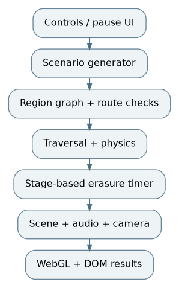

# The Last Page: Architecture, Implementation and Engineering Analysis

**ABProjects** · Technical Report · 17 October 2026

**Abstract.** A timed 3D exploration game in which a disappearing pencil world forces the player to navigate a route to the next page before erasure catches up. This report examines the actual shipped single-file architecture, execution model, engineering trade-offs, targeted improvements and validation limits. Statements about changes are grounded in the code supplied with this release. Performance improvements are presented as structural reductions in eligible work, not unmeasured frame-rate claims.

*Figure 1. Functional system view; all runtime subsystems remain within one self-contained HTML document.*

**Keywords:** HTML5, WebGL, Three.js, browser games, frame scheduling, game engineering, deterministic execution, source preservation.

## 1. Experience and objective

The Last Page places the player in a hand-drawn 3D world that is being erased. A run presents a starting area, a gate to another page and a time limit: the user must explore the environment and reach the destination before progressive erasure makes the world uninhabitable. The game emphasizes readable traversal, environmental geometry, an atmosphere of loss and a repeatable navigation-puzzle loop. The deployed build is a fully self-contained HTML file with embedded graphics, physics and audio material.

## 2. Embedded engine and systems

The release bundles Three.js 0.160.0 and a Rapier 0.14.0 physics/WASM runtime directly into the HTML. Audio samples are embedded rather than fetched at run time. The scene handles player movement, camera orientation, world collision, lighting, particle/weather effects and hand-drawn aesthetics. A higher-level `PWCreateNavigationGame` controller overlays scenario selection, validated gates, erasure stages, menus, pause, audio and results. The implementation preserves a single physical file for offline use and itch.io HTML5 deployment.

## 3. Navigation graph and scenario validation

The navigation layer indexes authored world geometry into traversable regions and a directed connectivity graph. It generates deterministic candidate spawn/gate pairs, assesses feasibility and route demand, and selects scenarios that meet constraints. The built-in `lpTestSeeds` evaluator can sample generated runs and report graph size, successful generation count, route lengths, regional hops, directness, timer ranges, unique spawn-to-gate pairs and failures. These are code-supported test facilities; this report does not invent empirical success rates for a seed sweep that was not run in a compatible WebGL browser.

## 4. Erasure mechanics and clock

The source declares five erasure stages and an eighteen-second stage duration, with a separate physical-erasure threshold. The challenge controller advances logical run time, updates hazards and adjusts visible level state against the current scenario. A critical invariant is that run time must advance only when the player can reasonably act; otherwise tab switching could consume the remaining countdown without user input. The uploaded version cleared input on browser blur and visibility loss, but did not always pause the active navigation state. The revision now calls the existing `PW_NAV_GAME.pause()` on both events. That method already freezes motion, exits pointer lock, pauses run audio and opens the pause screen, so it is safer than implementing a second pause mechanism.

## 5. Render loop and idle optimization

The principal frame loop uses `requestAnimationFrame` and a clamped frame delta (100 ms maximum) from the engine clock. While a run is active it updates input, movement, camera, environmental state, physics and drawing. In paused/result states it already freezes the simulation and optionally renders the scene as a backdrop. The revised code limits the backdrop draws to 10 Hz and suppresses WebGL rendering while the document is hidden. This optimization changes only non-active presentation frequency; it leaves active rendering cadence and world evolution as before. The paused UI stays DOM-driven and remains interactive.

## 6. Validation and limitations

All three inline JavaScript blocks pass syntax validation and the application still contains its embedded assets, graphics library, physics runtime and original scenario generator. The revisions are intentionally small: one focus-loss correctness fix and one idle-render throttle. A software-WebGL browser loaded the menu and started a timed scenario. Full route/physics completion tests have not been performed. The shipped checklist requires manual checks of startup, pointer lock, camera, seed-driven scenario, gate, erasure, pause/resume, focus switching, audio and result screens before production deployment.

## 7. Determinism, scenario feasibility and erasure state

A generated challenge is derived from a normalized input seed and seeded shuffling of precomputed candidate region pairs. A candidate contains a spawn, destination gate, separation estimate, route profile and demand score. Scenarios are filtered through validation and balancing constraints before the run begins. The automated `lpTestSeeds` routine is particularly valuable because it **generates each seed twice** and compares the normalized scenario snapshots. It classifies mismatches as non-determinism while also collecting route, region, timer and uniqueness statistics. This is a stronger reproducibility contract than simply accepting the first generated destination.

The erasure update walks region-level state, derives a continuous stage value from run elapsed time, and maps it onto an integer stage in `[0,5]`. A region becomes physically erased once its stage reaches the physical threshold. Visual effects (including translucent veils) are modulated by the fractional stage before final collapse. The system therefore has two related but distinct notions of progress: visual erasure and actual traversal viability. That separation must be preserved in any subsequent optimization because a visual-only change is not allowed to silently modify collision or route reachability.

The key timer invariant is `elapsed(t + delta) = elapsed(t) + delta` only while state is `active` and creative mode is disabled. The controller already returns immediately from updates in `paused`, `menu`, `startup` and terminal states. The source bug was the **missing transition into the paused state** on blur/tab hiding; it was not the arithmetic of `elapsed += delta`. The release fixes the transition by delegating to the existing idempotent `pause` method, which checks `state === "active"` before changing state and stopping audio.

## 8. Performance characteristics and failure prevention

The file embeds libraries and sound samples, and its roughly 5 MB text size is an intentional consequence of offline/self-contained delivery. Splitting the payload into external JavaScript, WASM or audio files would contradict the requested distribution model and introduce additional network and caching failure modes. No embedded libraries, level geometry, sounds, enemy/physics parameters or scenario selection algorithms are modified.

During active play the renderer continues to draw on each animation frame. During paused/result overlays the controller already freezes most world simulation, yet could still draw a full 3D backdrop every frame. The new 100 ms interval reduces eligible WebGL calls while that frozen backdrop is visible. The countdown is paused independently; the render optimization is not used to determine elapsed game time. The source retains its per-frame callback so DOM overlays and resumed interaction are responsive.

Window blur and `visibilitychange` are both handled because keyboard focus can be lost without a document becoming hidden, and background tabs can be hidden without a conventional blur sequence in every browser. The added handlers call the same public controller method and therefore tolerate duplicate delivery. Browser audio resume still requires an explicit user gesture, as in the original implementation.

## 9. Verification protocol

After starting a timed scenario, record `PW_ERASURE_SYSTEM.elapsed` or the displayed clock, Alt-Tab for ten seconds and verify the state is `paused` and elapsed time has not advanced. Repeat by switching browser tabs, then resume from a user click and verify audio returns. Test the result overlay's scene visibility, a seed that includes a multi-region route, and one successful gate arrival. For deterministic evaluation, execute `PW_ERASURE_SYSTEM.testSeeds(100)` from the game console in a compatible environment, record the returned failures and route statistics, and repeat on the same source revision. A virtual-desktop WebGL smoke test confirmed a timed run begins. The separate blur test is described below; seed-batch evaluation, route completion and hardware performance checks remain unverified.

## Controlled browser observations

The revised build initialized in Xvfb-hosted Chromium with WebGL software rendering, showed its menu, and entered an active timed run. A focused A/B regression test dispatched a window `blur` event after the run began. In the original, state stayed `active` and elapsed time rose from about 0.165 s to 0.365 s during the observation window. In the revision, state changed to `paused` and elapsed time remained approximately **0.1353 s** over the same wait. No uncaught JavaScript errors were observed. This is a narrow, real browser check of the focus-loss fix; it does not prove all scenario routes or erasure stages are bug-free.

## 10. Build structure and release integrity

The playable deliverable remains **`index.html`**. No source was split into imports, ES modules, bundles or fetched runtime resources. Documentation, diagnostics and GitHub publishing helpers are external to the playable game; they are not runtime dependencies. Original and updated SHA-256 values are recorded in `docs/RELEASE_MANIFEST.json`. The applied behavior changes are intentionally isolated and documented in `docs/RELEASE_NOTES.md`.

The included `tests/verify.mjs` checks that the repository contains a self-contained HTML document, runs JavaScript syntax validation, and confirms that the expected safety/performance markers are present. It is a smoke check, not a substitute for end-to-end playtesting on real graphics hardware.

## 11. Verification status

**Completed:** source inspection; successful parsing of every inline script using Node.js; HTML structural check; traceable, limited source patches; independent archive integrity checks. **Not completed:** GPU-accelerated frame benchmarks, exhaustive input-device testing, multiplayer/network testing (not applicable), long-run performance sampling, and full in-game visual regression. Initial headless Chromium could not initialize WebGL, but a virtual-desktop Chromium instance using SwiftShader subsequently loaded the game. Startup/menu smoke checks succeeded without uncaught JavaScript exceptions. No exhaustive game-playthrough, cross-browser matrix or GPU performance benchmark was performed.

## 12. Deployment and third-party notices

The playable build is distributed as one `index.html`. Local testing can be performed by opening it in a desktop browser; if browser security policies restrict a feature, serve the same file from a local HTTP server. Publishing to itch.io as an HTML5 game requires placing `index.html` at the root of the uploaded ZIP. See [the game's itch.io listing](https://abprojects.itch.io/the-last-page) for the existing public game page and any project imagery. Repository screenshots must be captured or downloaded and checked for permission before embedding; this release does not invent gameplay imagery.

The file contains embedded third-party engine/runtime code and licenses/attribution already carried inside its source. A public GitHub repository does **not** grant additional reuse rights by itself. No new overarching licence has been selected on the author's behalf.

## References

1. ABProjects, [The Last Page on itch.io](https://abprojects.itch.io/the-last-page), live project listing.
2. ABProjects, `index.html`, source release analyzed for this report.
3. Three.js, WebGL rendering library, embedded release code and notices.
4. ABProjects, `docs/RELEASE_MANIFEST.json` and `tests/verify.mjs`, release verification evidence.
